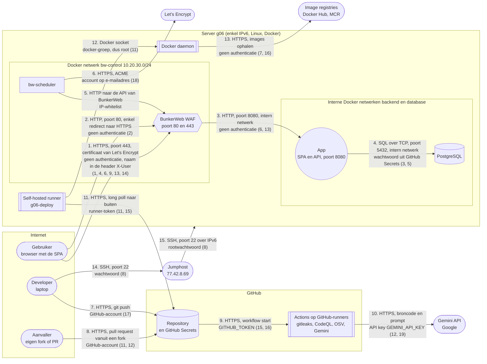

# Threat model van Unbreakable (opdracht 2: pipeline, AI agent en WAF)

Groep g06, Moha & Jasper. Dit model vertrekt van het basismodel van de starter app en voegt toe wat er in opdracht 2 bijkwam: de pipeline in GitHub Actions, de self-hosted runner op de server, de AI agent (Gemini) en BunkerWeb als WAF met HTTPS via Let's Encrypt. De nummers tussen haakjes op het diagram zijn de dreigingen uit de tabel hieronder.

## Architectuur

Vertrouwensgrenzen: tussen het internet en BunkerWeb, tussen BunkerWeb en de interne Docker netwerken, tussen GitHub en de server (de runner haalt jobs op en voert ze uit met Docker), en tussen GitHub Actions en externe diensten (Gemini, de registries). De app en de databank publiceren zelf geen poorten meer: poort 8080 is enkel bereikbaar via BunkerWeb.

Wat er veranderde tegenover het basismodel: flow 1 en 2 gaan nu over HTTPS via de WAF in plaats van HTTP op poort 8080, het databankwachtwoord komt uit GitHub Secrets, en flow 7 tot 13 zijn nieuw door de pipeline en de AI agent.

## Dreigingen

Formulering: een A doet B op C door D, wat leidt tot E.

| # | STRIDE | Dreiging | Maatregel | Status |
|---|---|---|---|---|
| 1 | Spoofing | Een gebruiker zet de naam van iemand anders in de header X-User, door het ontbreken van authenticatie, wat leidt tot het lezen van andermans berichten | Inloggen via een identity provider, tokens die de API valideert | Open, opdracht 4 |
| 2 | Information disclosure | Een aanvaller luistert het verkeer af op flow 1 en 2, door het gebruik van HTTP, wat leidt tot het lekken van berichten | HTTPS via BunkerWeb met Let's Encrypt, HTTP stuurt door naar HTTPS | Opgelost in opdracht 2 |
| 3 | Information disclosure | Een beheerder of aanvaller met toegang tot de databank leest alle berichten, doordat ze onversleuteld bewaard worden, wat leidt tot verlies van vertrouwelijkheid | End to end encryptie | Open, opdracht 3 |
| 4 | Elevation of privilege | Een gebruiker vraagt een bericht op of verwijdert het met het id van iemand anders, door het ontbreken van autorisatie, wat leidt tot het lezen of verwijderen van andermans berichten | Autorisatie per bericht | Open, opdracht 5 |
| 5 | Information disclosure | Iemand met toegang tot de repository leest het databankwachtwoord, doordat het in de configuratie staat, wat leidt tot volledige toegang tot de databank | Wachtwoord voor de deploy in GitHub Secrets (DB_PASSWORD), databank enkel op een intern netwerk | Deels: staat nog in appsettings.json en in de git-geschiedenis, opdracht 6 |
| 6 | Tampering | Een aanvaller stuurt kwaadaardige invoer via een invoerveld (SQL-injectie, XSS), door onvoldoende validatie of encoding, wat leidt tot het uitvoeren van code of queries | SAST in de pipeline, WAF met de OWASP Core Rule Set, later secure coding | Deels: de WAF houdt de gekende vormen tegen, zie 13 |
| 7 | Tampering | Een aanvaller verstopt kwaadaardige code in een bibliotheek die de app gebruikt, door het ontbreken van controle op afhankelijkheden, wat leidt tot overname van de app | SCA met OSV-Scanner in de pipeline | Deels: OSV ziet jQuery en Bootstrap in wwwroot/lib niet, er is geen manifest |
| 8 | Spoofing | Een aanvaller raadt het rootwachtwoord van de server via flow 14 en 15, door aanmelden met wachtwoord, wat leidt tot overname van de server | SSH sleutels, fail2ban, wachtwoorden niet delen | Open |
| 9 | Denial of service | Een aanvaller overspoelt de app met requests, door het ontbreken van rate limiting, wat leidt tot onbeschikbaarheid | Rate limiting en bad behavior in BunkerWeb | Opgelost in opdracht 2, maar zie 14 |
| 10 | Repudiation | Een gebruiker ontkent dat hij een bericht stuurde, doordat de afzender niet bewezen wordt en er geen logging is, wat leidt tot discussie zonder bewijs | Authenticatie, handtekeningen en logging | Open, opdracht 3 en 4 |
| 11 | Elevation of privilege | Een aanvaller opent een pull request vanuit een fork met een workflow die op de self-hosted runner draait, doordat de runner aan een publieke repo hangt, wat leidt tot code uitvoeren op de server met Docker-rechten (root) | Goedkeuring voor workflows van alle externe bijdragers, de runner enkel gebruiken in de deploy-job op main | Open: instelling zetten in Settings, Actions |
| 12 | Tampering | Een aanvaller verstopt instructies in de code of de beschrijving van een pull request (prompt injection), doordat de AI agent die inhoud leest, wat leidt tot een misleidende review of misbruik van zijn rechten | De agent mag enkel lezen en drie GitHub-tools gebruiken, geen secrets voor forks (pull_request), minimale rechten, een mens beslist over de merge | Opgelost in opdracht 2 |
| 13 | Tampering | Een aanvaller zet de SQL-injectie in de header X-User in plaats van in de zoekterm, doordat de Core Rule Set eigen headers niet controleert, wat leidt tot het lezen van alle berichten ondanks de WAF | Geparameteriseerde queries in de code, de WAF is enkel een extra laag | Open, aangetoond in opdracht 2 |
| 14 | Denial of service | Een aanvaller lokt met opzet een reeks 403's uit, doordat BunkerWeb elke bezoeker ziet als 10.20.30.1 (Docker over IPv6), wat leidt tot een ban van iedereen, ook van de healthcheck van de deploy | IPv6 in Docker aanzetten zodat het echte IP doorkomt, of het IP van de healthcheck whitelisten | Open |
| 15 | Information disclosure | Iemand met schrijfrechten of een overgenomen action leest de GitHub Secrets (GEMINI_API_KEY, DB_PASSWORD) via een aangepaste workflow, doordat secrets beschikbaar zijn in jobs, wat leidt tot misbruik van de key en toegang tot de databank | Secrets enkel in de jobs die ze nodig hebben, minimale permissions, branch protection op main | Deels |
| 16 | Tampering | Een aanvaller neemt een action of image over die enkel op een tag staat (bv. @v0), doordat tags verplaatst kunnen worden, wat leidt tot eigen code in de pipeline met toegang tot secrets en de runner | Actions en images vastpinnen op een commit of digest | Deels: OSV, upload-artifact en de play staan vast, de rest nog niet |
| 17 | Tampering | Iemand pusht rechtstreeks naar main, door het ontbreken van branch protection, wat leidt tot code online zonder review van een collega of de AI agent | Ruleset op main: pull request en groene checks verplicht | Open |
| 18 | Denial of service | De WAF vraagt bij elke deploy een nieuw certificaat aan, doordat het certificaat niet bewaard wordt, wat leidt tot de gedeelde limiet van Let's Encrypt en een site zonder geldig certificaat | Certificaat bewaren in het volume bw-storage | Opgelost in opdracht 2 |
| 19 | Information disclosure | De AI agent stuurt broncode en configuratie naar de Gemini API, doordat hij de repository leest, wat leidt tot het lekken van geheimen als die in de code staan | Geen echte geheimen in de code (GitHub Secrets), bibliotheken uitgesloten met .geminiignore | Opgelost in opdracht 2 |
