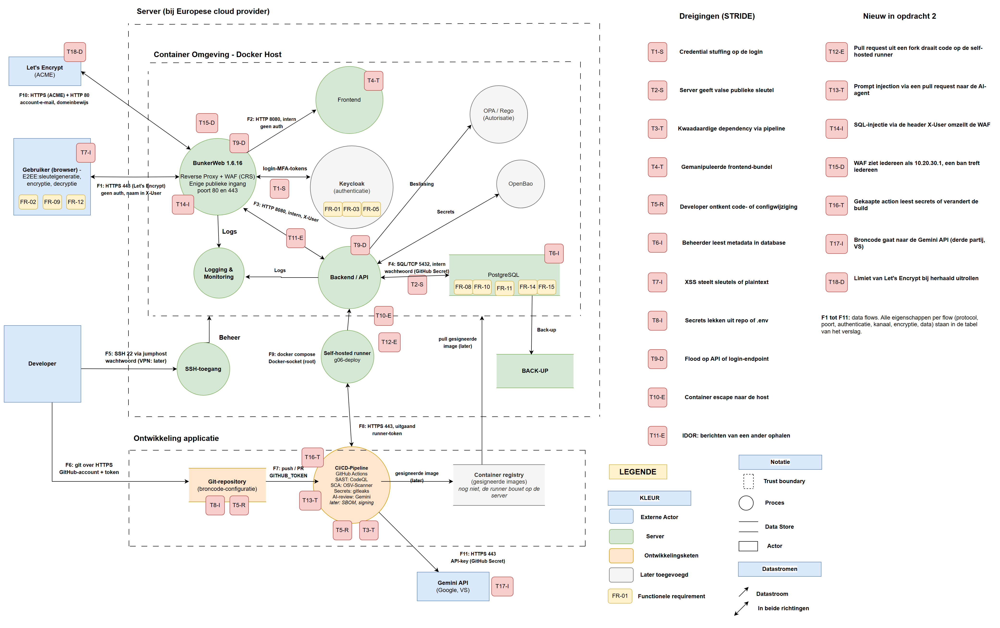

# Threat model, stand na opdracht 2

Groep g06, Jasper Vanhoutte en Mohammed Ben Hammou.

Dit is het threat model uit opdracht 1, aangevuld met wat er in opdracht 2 gebouwd werd: de pipeline in GitHub Actions, de self-hosted runner, de AI-agent (Gemini) en BunkerWeb met HTTPS via Let's Encrypt. Het is één model dat meegroeit, geen nieuw. De nummers T1 tot T11 zijn die van opdracht 1, T12 tot T18 zijn nieuw.

De tekening is `architectuur-opdracht2.drawio` (draw.io). Groen en oranje is gebouwd, grijs komt later. Op elke gebouwde flow staat een nummer F1 tot F11 met protocol, poort en authenticatie. De rode labels zijn de dreigingen, bij het onderdeel waar ze horen.

## Data flows

| Nr | Van → naar | Protocol | Poort | Authenticatie | Kanaal | Encryptie | Data |
|---|---|---|---|---|---|---|---|
| F1 | Gebruiker → BunkerWeb | HTTPS | 443 | geen, naam in de header `X-User` | internet (IPv6) | TLS (Let's Encrypt), nog geen E2EE | SPA, berichten in JSON |
| F2 | BunkerWeb → frontend (SPA) | HTTP | 8080 | geen | intern Docker-netwerk `backend` | geen | statische bestanden |
| F3 | BunkerWeb → backend / API | HTTP | 8080 | geen, naam in `X-User` | intern Docker-netwerk `backend` | geen | API-verzoeken in JSON |
| F4 | Backend → PostgreSQL | SQL over TCP | 5432 | wachtwoord (GitHub Secret `DB_PASSWORD`) | intern Docker-netwerk `database` | geen | berichten, leesbaar |
| F5 | Developer → server | SSH via de jumphost | 22 | wachtwoord (root) | internet, jumphost, IPv6 | SSH | beheer |
| F6 | Developer → GitHub | git over HTTPS | 443 | GitHub-account en token | internet | TLS | broncode |
| F7 | GitHub → pipeline | push- of PR-event | n.v.t. | `GITHUB_TOKEN` met minimale rechten | binnen GitHub | TLS | commit of pull request |
| F8 | Self-hosted runner → GitHub | HTTPS, uitgaand (long poll) | 443 | runner-token | internet | TLS | jobs en logs |
| F9 | Runner → Docker | Docker API over een Unix-socket | n.v.t. | lokaal, docker-groep (praktisch root) | lokaal op de server | geen | `docker compose build` en `up` |
| F10 | BunkerWeb ↔ Let's Encrypt | HTTPS (ACME) en HTTP-challenge | 443 en 80 | ACME-account (e-mail), bewijs van domeinbeheer | internet | TLS | certificaat |
| F11 | Pipeline → Gemini API | HTTPS | 443 | API-key (GitHub Secret `GEMINI_API_KEY`) | internet | TLS | broncode en prompt |

## Dreigingen uit opdracht 1

| # | STRIDE | Dreiging | Maatregel uit opdracht 1 | Stand na opdracht 2 |
|---|---|---|---|---|
| T1 | S | Credential stuffing op de login | Gelekte wachtwoorden checken, MFA, rate limiting | Open, opdracht 4. Er is nog geen login. |
| T2 | S | Server geeft een valse publieke sleutel | Fingerprints of safety numbers | Open, opdracht 3 |
| T3 | T | Kwaadaardige dependency via de pipeline | SCA in de pipeline, SBOM | Deels. OSV-Scanner blokkeert nieuwe kwetsbare packages. Nog geen SBOM, en OSV ziet jQuery en Bootstrap in `wwwroot/lib` niet. |
| T4 | T | Gemanipuleerde frontend-bundel | Lockfile met hashes, alleen via de pipeline, images signeren | Deels. De frontend gaat alleen via de pipeline online, exact de gescande commit. Nog geen signing en geen registry. |
| T5 | R | Developer ontkent een code- of configwijziging | Eigen accounts, signed commits, branch protection met review | Deels. Eigen GitHub-accounts en alles in de git-geschiedenis. Nog geen signed commits en geen branch protection: op 19 okt werd nog rechtstreeks naar main gepusht. |
| T6 | I | Beheerder leest metadata in de databank | Berichten verwijderen, padding | Open, opdracht 3 |
| T7 | I | XSS steelt sleutels of plaintext | Sanitisation, output encoding | Deels. CodeQL vindt de DOM-XSS en de WAF blokkeert `<script>`. De stored XSS via het onderwerp zit nog in de code. |
| T8 | I | Secrets lekken uit de repo of `.env` | `.env` in `.gitignore`, gitleaks in CI, secret manager | Deels, vervroegd. gitleaks draait bij elke push, pipeline-secrets staan in GitHub Secrets. Het wachtwoord staat nog in `appsettings.json` (opdracht 6). |
| T9 | D | Flood op de API of de login | Rate limiting in de WAF | Opgelost met de rate limiting van BunkerWeb, maar zie T15 |
| T10 | E | Container escape naar de host | Non-root containers, rootless Docker | Open. De app draait als root in de container en de runner heeft via de docker-groep root-rechten. |
| T11 | E | IDOR: berichten van een ander ophalen | Autorisatie per request | Open, opdracht 5. De AI-agent vond het ook. |

## Nieuwe dreigingen door de pipeline en de WAF

| # | STRIDE | Dreiging | Maatregel | Stand |
|---|---|---|---|---|
| T12 | E | Een pull request uit een fork draait code op de self-hosted runner, met Docker-rechten op de server | Goedkeuring voor workflows van alle externe bijdragers, deploy alleen bij een push naar main | Beperkt |
| T13 | T | Prompt injection: tekst in een pull request stuurt de AI-agent | De agent mag alleen lezen en drie GitHub-tools gebruiken, forks krijgen geen secrets, een mens beslist over de merge | Beperkt |
| T14 | I | SQL-injectie via de header `X-User` omzeilt de WAF en leest alle berichten | Queries met parameters in de code, echte authenticatie | Open, aangetoond in opdracht 2 |
| T15 | D | De WAF ziet elke bezoeker als 10.20.30.1, dus een ban na te veel 403's treft iedereen, ook de healthcheck | IPv6 op het Docker-netwerk zodat het echte IP doorkomt | Open |
| T16 | T | Een gekaapte action leest de secrets of verandert de build | Actions vastpinnen op een commit-SHA, minimale `permissions` | Deels: OSV, upload-artifact en de play staan vast, de andere actions nog niet |
| T17 | I | De broncode gaat naar de Gemini API, een Amerikaanse derde partij | Geen echte geheimen of persoonsgegevens in de repo, bibliotheken uitgesloten, later een Europees of eigen model | Aanvaard voor deze oefenapp |
| T18 | D | Bij herhaald uitrollen raakt de gedeelde limiet van Let's Encrypt op | Certificaat bewaren in het volume `bw-storage` | Opgelost |

Buiten scope blijft wat al in opdracht 1 stond, plus aanvallen op GitHub, Google of Let's Encrypt zelf.
